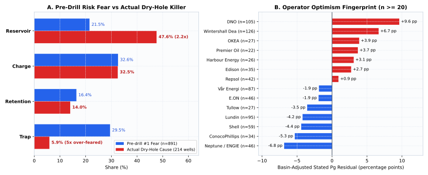

# Screened Relinquished Prospect Inventory and Conditional Audit of 756 NCS Licences

**Bottom line.** Cleaning 756 Norwegian Continental Shelf relinquishment reports (`10.5281/zenodo.24528585`, 738 unique licences and 5,325 prospects) and joining their Norwegian-sector-clipped polygons against 536 active SODIR licences, the APA gross boundary, and 154 in-service surface host facilities identifies **242 APA-eligible open-acreage prospects (`Pg >= 0.20`, post-award assessed, undrilled, >=50% of the Norwegian slice outside active licences) holding 6.30 Bboe unrisked and 1.95 Bboe risked**. Within that APA-open inventory, **178 prospects (1.31 Bboe risked) were dropped for commercial or non-technical reasons**, **90 prospects (0.63 Bboe risked) lie within 30 km of a fluid-compatible surface host**, and **four core Tier A gas prospects within 52 to 71 km of Aasta Hansteen total 457.1 MMboe unrisked (192.8 MMboe risked)**. Since 2013, **nearly one in five completed NCS wildcats (77 of 401, 19.2%) was drilled inside a previously relinquished prospect polygon**. Controlling for distance to the nearest prior discovery via logistic regression shows **no significant overall penalty** (main-effects OR = 0.76, p = 0.33; binned 42.9% vs 52.0%, -9.1 pp, z = -1.60), **but a robust near-field penalty that fades with distance** (`is_redrill x log1p(dist_km)` coef = +0.98, p = 0.0018; p = 0.0116 excluding all wells beyond 40 km), where near-field (`<= 15 km`) redrills trail peers by **-16.9 pp (44.1% vs 60.9%, z = -2.65)** while mid-field and frontier redrills cannot be distinguished from peers. All in-licence calibration and shrinkage metrics are strictly **conditional on relinquishment**.

---

## 1. APA-Eligible Open-Acreage Inventory and Tieback Shortlist

**Bottom line.** Filtering to georeferenced, post-award assessed, undrilled, non-redrilled prospects with `Pg >= 0.20` (`n = 408`, 3.07 Bboe risked) and clipping polygons to the Norwegian sector yields **242 APA-eligible open prospects (1.95 Bboe risked)** plus 1 prospect in non-APA numbered-round acreage.

- **Explicit filter hierarchy.** Removing pre-work application-only assessments (such as Wegener and Nobel in PL694), removing prospects already penetrated by post-relinquishment SODIR wildcats (such as Celsius and Herzer), and deduplicating straddling names leaves 408 georeferenced prospects. Splitting the 242 APA-open prospects by drop reason separates **Tier A (commercial or non-technical drop reasons, 178 prospects, 1.31 Bboe risked)** from **Tier B (technical or geological-risk drop reasons, 64 prospects, 0.64 Bboe risked)**.
- **Norwegian-sector clipping and depth-limited licences.** Sampled polygon points were clipped to the Norwegian sector (APA gross boundary plus active Norwegian licences) before computing the open fraction so foreign acreage across median lines (such as the UK portion of Edinburgh) never counts as open Norwegian ground. None of the re-licensed prospects overlapped a stratigraphically depth-limited active licence (`prlStratigraphical == YES`).
- **Fluid-aware surface host matching.** Haversine distance was computed to 154 in-service surface facilities in SODIR `facility_fixed`, excluding oil-only gas-reinjection FPSOs (such as Goliat and Johan Castberg) when matching gas prospects. Only surface facilities are included, subsea templates and pipeline tie-in points are excluded, and real tieback feasibility still depends on host ullage and HPHT specifications. **90 APA-open prospects (0.63 Bboe risked)** sit within 30 km of a fluid-compatible surface host.
- **Aasta Hansteen Voring gas cluster.** Four Tier A Cretaceous gas prospects within 52 to 71 km of Aasta Hansteen (Kelvin, Fjellflokk Far East 1, Svartbakkestjerne Springar, and Birkeland) total **457.1 MMboe unrisked and 192.8 MMboe risked** (with Tier B Maiblom 145.8 km from Aasta Hansteen adding 143.0 MMboe unrisked / 45.8 MMboe risked). Summing risked volumes gives expected value only; because these prospects share Cretaceous Nise/Springar play risk, a hub evaluation requires separating shared play chance from prospect-specific chance.
- **Deduplication and coordinate caveats.** 18 duplicate multi-licence PDF pairs were collapsed to 738 unique licences and three 1,000x unit bugs (`PL531_JURASSIC`, `PL1019`, `PL883 Taren East`) were fixed. Undrilled status relies on surface wellheads rather than bottom-hole coordinates, so deviated wells spudded outside a polygon could have tested some targets.

### Source-Audited Top APA-Eligible Open-Acreage Prospects

Ranked rows appear first by risked volume; caveated rows (median-line split or unstated volume basis) are listed separately at the bottom and are not ranked.

| Prospect | Licence (Year) | Basin | Tier | Pg | Unrisked / Risked (MMboe) | NO Area / Open % | Nearest Fluid-Compatible Surface Host (km) | Source Audit |
| --- | --- | --- | --- | --- | --- | --- | --- | --- |
| Kelvin | PL653 (2016) | Norwegian Sea | Tier A | 35% | 184.9 / 64.7 | 100% / 100% | Aasta Hansteen Spar (52.3) | Verified p.10 (29.4 BCM rec gas) |
| Sjampis | PL695 (2021) | Barents Sea | Tier A | 25% | 223.3 / 55.8 | 100% / 100% | Goliat FPSO (124.5) | Verified p.12 (35.5 MSm3 rec oil) |
| Fjellflokk Far East 1 | PL847 (2020) | Norwegian Sea | Tier A | 60% | 87.4 / 52.5 | 100% / 100% | Aasta Hansteen Spar (65.4) | Verified p.26 (13.9 GSm3 rec gas) |
| Bjork Intra Heather Lower | PL1051 (2023) | North Sea | Tier B | 21% | 240.5 / 50.5 | 100% / 100% | Gjoa (24.5) | Verified SODIR form p.15 (38.2 MSm3 rec oil, coal risk) |
| Svartbakkestjerne Springar | PL847 (2020) | Norwegian Sea | Tier A | 42% | 118.1 / 49.6 | 100% / 100% | Aasta Hansteen Spar (71.0) | Verified p.31 (663 bcf rec gas) |
| Faering East (Ula) | PL809 (2018) | North Sea | Tier B | 34% | 136.0 / 46.2 | 100% / 100% | Tambar (14.3) | Verified p.6 (136 Mboe = million boe, outside PL809) |
| Maiblom | PL944 (2021) | Norwegian Sea | Tier B | 32% | 143.0 / 45.8 | 100% / 94% | Aasta Hansteen Spar (145.8) | Verified p.14 (143 mmboe rec) |
| Faering South | PL809 (2018) | North Sea | Tier A | 29% | 146.0 / 42.3 | 100% / 100% | Tambar (11.7, HPHT / unmanned caveat) | Verified p.4 and Table 5 (23.5 MSm3 oe, 5,100 m HPHT) |
| Firebird | PL678S (2017) | North Sea | Tier B | 28% | 122.3 / 34.2 | 100% / 100% | Ringhorne (56.6) | Verified p.41 (122.3 mmboe Brent) |
| Fannaraken | PL450 (2014) | North Sea | Tier B | 30% | 90.6 / 27.2 | 100% / 100% | Ula QP (14.5, HPHT gas caveat) | Verified p.27 (14.4 GSm3 HPHT gas) |
| Arenaria | PL709 (2017) | Barents Sea | Tier A | 56% | 47.9 / 26.8 | 100% / 100% | Melkoya LNG (214.0) | Verified p.14 (7.61 GSm3 tight gas) |
| Birkeland | PL694 (2016) | Norwegian Sea | Tier A | 39% | 66.7 / 26.0 | 100% / 100% | Aasta Hansteen Spar (51.9) | Verified p.10 (10.6 BCM rec gas) |
| *Caveated (unranked)* Edinburgh | PL660 (2016) | North Sea | Tier A | 44% | ~46.5 / ~20.5 (NO share) | 67% / 100% | Ekofisk B (31.0) | Verified p.24 (211.5 gross, ~22% in Norway, JWA failed) |
| *Caveated (unranked)* Jaktfalk | PL595 (2014) | Barents Sea | Tier A | 28% | 170.5 / 47.7 | 100% / 100% | Goliat FPSO (92.5) | Caveat p.8 (basis and risking unstated) |

---

## 2. Outcome-Blind Parent-Well Redrills with Maturity Control

**Bottom line.** Across all 401 completed NCS wildcat parent wells from 2013 through 2026 (including all 77 completed post-relinquishment redrills, 19.2% of shelf wildcats, excluding 4 uncompleted wells with `wlbCompletionYear == 0`), a single logistic regression controlling for `log1p(distance_to_prior_discovery)`, basin, and 5-year period finds **no significant overall redrill penalty** (main-effects OR = 0.76, p = 0.33; binned 42.9% vs 52.0%, -9.1 pp, z = -1.60), **but a robust near-field penalty that fades with distance** (`is_redrill x log1p(dist_km)` coef = +0.98, p = 0.0018; p = 0.0011 capped at 40 km; p = 0.0116 dropping all wells beyond 40 km). Mid-field (`n = 13`) and frontier (`n = 5`) redrills cannot be distinguished from peers.

**Method.** Undrilled relinquished prospect polygons were joined by point-in-polygon to completed SODIR wildcats (`wlbCompletionYear > report_year`, excluding 4 uncompleted wells recorded with `wlbCompletionYear == 0`) and collapsed to one observation per parent well (`wlbWell`, `n = 77`). Outcome-blind stratigraphic penetration used `wellbore_formation_top.parquet` mapped via `strat_litho_overview` (60 wells), falling back to `wlbAgeAtTd` only where a well had zero formation tops loaded (14 wells, never using `wlbAgeWithHc*`). Distance to the nearest prior hydrocarbon discovery completed strictly before each well's completion year was computed for all 401 completed wildcat parent wells (`2013+`) and tested both via continuous logistic regression (eliminating bin-edge choices) and via reconciled `(basin, maturity_bin, 5-year)` leave-out bins (`59 + 13 + 5 = 77`).

| Reconciled Parent-Well Cohort (`wlbCompletionYear > 0`) | Parent Wells (n) | Discoveries | Observed Rate | Maturity+Basin+5yr Baseline | Diff (pp) | Test |
| --- | --- | --- | --- | --- | --- | --- |
| All completed redrill parent wells | 77 | 33 | 42.9% | 52.0% | -9.1 | z = -1.60 |
| Near-field (`<= 15 km` to prior discovery) | 59 | 26 | 44.1% | 60.9% | -16.9 | z = -2.65 |
| Mid-field (`15 to 40 km`) | 13 | 4 | 30.8% | 24.3% | +6.5 | Small n (indistinguishable) |
| Frontier (`> 40 km`) | 5 | 3 | 60.0% | 18.0% | +42.0 | Small n (anecdotal) |

- **Cutoff sensitivity and leverage check.** Across nested distance cutoffs (`51` subset of `59` subset of `65` subset of `68` wells, so these are nested sensitivity checks rather than independent samples), the near-field deficit holds at `<= 10 km` (-23.0 pp, z = -3.38), `<= 15 km` (-16.9 pp, z = -2.65), `<= 20 km` (-15.8 pp, z = -2.58), and `<= 30 km` (-16.3 pp, z = -2.72). In the main-effects logistic regression (`n = 401`), `log1p(dist_km)` lowers discovery odds with OR = 0.58 (p < 0.0001). In the interaction model, the non-redrill `log1p(dist_km)` slope is OR = 0.48 (p < 0.0001), `is_redrill` lowers odds near existing discoveries (coef = -2.42, p = 0.0012), and the positive interaction (`+0.98`, p = 0.0018) indicates a near-field penalty that fades with distance. Capping distance at 40 km (`coef = +1.12`, p = 0.0011) or excluding all wells beyond 40 km (`n = 369`, 72 redrills, `coef = +1.00`, p = 0.0116) confirms the interaction is not driven by the 5 frontier wells.
- **Working hypothesis.** A plausible hypothesis for this interaction is that operators retain and drill the highest-quality structures near existing discoveries in active licences, leaving harder marginal near-field targets to be relinquished, whereas outboard relinquishments are more often driven by infrastructure or commercial constraints.
- **Standalone fields vs satellites.** `6506/11-10 Berling` (2018, relinquished twice by Det norske in 2011 and Centrica in 2015) and `31/7-1 Bestla` (2016, dropped by Lundin in 2013) represent standalone field discoveries. `6507/4-2 S Adriana` (`DVALIN`) and `36/7-5 B` (`DUVA`) are near-field satellites.
- **Coordinate limitation.** FactPages coordinates reflect surface wellheads rather than bottom-hole reservoir penetrations.

---

## 3. Exploratory P90 to P10 Volume Coverage Note

**Bottom line.** Across 10 standalone SODIR discoveries (`discovery_reserves`) matched to tight (`<= 100 km2`) relinquished polygons with pre-drill `[P90, P10]` ranges, 8 of 10 (80.0%, 95% Wilson CI 49% to 94%) fall inside `[P90, P10]`, with 2 above P10, 0 below P90, and a median actual-to-pre-drill-mean ratio of 1.11x.

- **Caveats.** Sample size (`n = 10`, CI 49% to 94%) cannot separate good calibration from under-coverage, matching only later discoveries introduces upward selection bias, and the ranges are the relinquishing operator's post-shrinkage estimates rather than the discovering operator's pre-drill estimates. Four multi-well `field_reserves` matches are excluded.

---

## 4. Conditional Patterns Inside Relinquished Licences

**Bottom line.** All metrics in this section are **conditional on licence relinquishment**. Because licences with commercial discoveries or growing prospects generally remain active, sample conditioning shifts outcomes toward lower discovery rates and shrinking volumes.

- **Conditional in-licence discovery rate (`n = 138`).** Within relinquished licences, mean stated pre-drill `Pg` is 27.0% against an 18.1% realized hydrocarbon discovery rate (-8.9 pp, p = 0.0134), reflecting disappointment inside dropped licences rather than unconditional shelf-wide calibration.
- **Conditional award-to-relinquishment volume drift.** Among re-evaluated pairs with both award and relinquishment assessments (`n = 183` mean volume, `n = 165` risked volume), 79.2% shrink in mean volume (median -52.0%) and 83.0% lose risked volume (median -61.4%). Decade drift comparisons are omitted due to right-censoring of 2020s licences.
- **Conditional dry-hole causes (`n = 214` dry holes).** Reservoir absence or quality accounts for 47.6% of documented dry-hole causes vs 21.5% of pre-drill top risk ratings, while trap accounts for 5.9% of dry-hole causes vs 29.5% of pre-drill top risk ratings. Both selection (trap-risked prospects are often dropped undrilled) and diagnosis bias (water-wet good reservoir is often attributed to charge rather than trap) contribute to this gap.
- **Operator Pg spread.** Basin-adjusted stated `Pg` spans 16.5 pp across major operators (`n >= 20`, DNO +9.6 pp and Wintershall Dea +6.7 pp vs Neptune/ENGIE -6.8 pp, ConocoPhillips -5.3 pp, Shell -4.4 pp, and Lundin -4.2 pp). Without unconditional outcomes and play/vintage controls, this reflects reporting conventions and portfolio mix rather than proven optimism.

---

## 5. DHI Patterns and 18-PDF Extraction Reproducibility

**Bottom line.** Across drilled prospects in the atlas, positive DHI yields a 54.2% technical discovery rate vs 22.6% for negative DHI (p = 5.6e-5), reproducing known NCS DHI behavior (including Barents uplift gas expansion, where positive DHI lifts technical success 2.5x from 26.9% to 68.4% with 84.6% gas-only hits vs 6.7% in the North Sea). Across 18 duplicate joint-licence PDFs independently processed twice by Claude, true VLM map digitizations (`n = 52`, excluding GIS shapefiles) show 0.861 median polygon IoU and 116.8 m median centroid shift.

- **Flat-spot contrast (exploratory).** Claimed `flat_spot` prospects hit 28.0% (7/25) overall and 12.5% (1/8) in the North Sea vs 69.0% (29/42) for positive `amplitude_conformance` (unadjusted Fisher p = 0.0018, not corrected for multiple testing).
- **Reproducibility vs accuracy.** Inter-run agreement on the 18 duplicate PDFs (100.0% reservoir period, 95.5% `Pg`, 92.2% volume, 0.861 median VLM polygon IoU) measures self-consistency only, not ground-truth accuracy, since repeated runs can share systematic extraction errors.

---

## Reproducibility

- Shared loader and deduplicator `src/loader.py`
- Maturity-controlled parent-well audit, formation-top-first strat matching, Norwegian-sector-clipped APA screen, and fluid-aware host ranking `analyses/track6_production_audit.py`
- Maturity reconciliation, 10/15/20/30 km sensitivity, and logistic regression `analyses/track7_reconcile_and_logit.py`
- Earlier exploratory track scripts `analyses/track1_redrilled_graveyard.py` through `analyses/track5_reviewer_upgrades.py`
- Matplotlib PNG and SVG generator `analyses/generate_figures.py`
