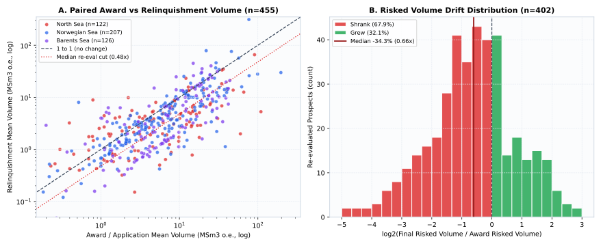

# Screened Relinquished Prospect Inventory and Pre-Registered Audit of 756 NCS Licences

**Bottom line.** Joining 738 unique Norwegian Continental Shelf relinquishment reports (5,325 prospects) against 536 active SODIR licences (FactPages and FactMaps snapshot `2026-11-25`, reflecting 56 APA 2025 awards), the APA gross boundary, and 154 in-service surface host facilities identifies **242 APA-eligible open-acreage prospects (`Pg >= 0.20`, post-award assessed, undrilled, >=50% of the Norwegian slice outside active licences) holding 6.30 Bboe unrisked and 1.95 Bboe risked**. Applying an empirical `tau = 0.10` PDO lower volume envelope flags 128 small prospects (0.40 Bboe risked), leaving **114 prospects above the envelope (1.55 Bboe risked)**, while **89 pure Tier A commercial or non-technical drops hold 0.81 Bboe risked** after a 30-prospect manual audit (86.7% pre-tightening agreement). Five Tier A infrastructure-constrained prospects saw nearest host distance drop by at least 20 km via Johan Castberg (2025) and Irpa PDO. In pre-registered cluster-robust regressions across 410 completed NCS wildcat parent wells (`2013+`, 19.2% redrills), the near-field redrill penalty and distance interaction **survive licence and quadrant clustering on technical discoveries** (`is_redrill x log1p(dist_km)` coef = +0.98, most conservative p = 0.0043) and survive controlling for operator incumbency (p = 0.0351), **but weaken to non-significance on material discoveries (`>= 3 MSm3`, most conservative p = 0.1304) and vanish on commercial discoveries (`2013 to 2021`, p = 0.8511)**. Incumbency itself strongly predicts discovery across all outcomes (OR = 2.33 technical, p = 0.0111; OR = 3.98 material, p = 0.0015; OR = 13.92 commercial, p < 0.0001), with a significant negative `is_redrill x incumbent` interaction (OR = 0.26 technical, p = 0.0314; OR = 0.16 material, p = 0.0295), favouring a combined explanation where operators retain superior near-field structures and incumbents hold an information edge on fresh near-field targets that disappears on relinquished ground. Reconciling dry-hole causes (`2007 to 2019`, `n = 110`, 90% manual audit agreement) under SODIR's three-category scheme shifts North Sea shares to 41.2% Charge, 20.2% Trap, and 38.6% Reservoir (vs SODIR's 47%, 29%, and 24%).

---

## 1. APA-Eligible Open-Acreage Inventory, Economic Screen, and Changed Circumstances

**Bottom line.** Out of 242 APA-eligible open prospects (`1.95 Bboe` risked, median `5` years open, `35.1%` with at least one new licence awarded within 20 km since relinquishment), **114 prospects (`1.55 Bboe` risked)** clear the empirical `tau = 0.10` PDO volume envelope, **89 pure Tier A prospects (`0.81 Bboe` risked)** were dropped without geological-risk tags, and **5 infrastructure-constrained Tier A prospects** moved at least 20 km closer to a host after Johan Castberg (2025) and Irpa PDO.

- **Data snapshot and APA 2025.** All SODIR FactPages and FactMaps layers were pulled on `2026-11-25` and include `56` APA 2025 awards. Full machine-readable outputs with all new columns live in `reports/open_acreage_inventory.csv` and `reports/open_acreage_inventory.geojson`.
- **Step 5 redrill re-risking calibration.** Across `57` completed redrill parent wells matched to a relinquished prospect with stated `Pg` (`39` near-field `<= 15 km`, `18` far-field `> 15 km`, outcome = hydrocarbons in the target stratigraphic period via `wlbAgeWithHc1..3`), observed-to-stated `Pg` ratios are **1.654 (95% bootstrap CI 1.107 to 2.312)** near-field and **1.888 (95% CI 1.033 to 2.622)** far-field. Because both CIs exclude `1.0`, `re_risked_pg` applies those multipliers (capped at `0.95`). Both columns are shown side by side because redrilled prospects represent the re-screened ~4% of relinquished ground rather than a random draw, so `re_risked_pg` is an upper bound conditional on re-selection.
- **Step 6 data-driven economic screen.** From `82` SODIR discoveries reaching PDO/production since `2010` (`63` oil, `19` gas), fitting `tau = 0.10` quantile regressions (`log(oe) ~ dist_km`) flags **128 of 242** APA-open prospects below the lower envelope, removing `397.3 MMboe` (`0.40 Bboe`) risked and leaving **114 prospects (`1.55 Bboe` risked)**.
- **Step 7 changed-circumstances screen.** Five Tier A prospects dropped for infrastructure/distance saw nearest host distance drop by at least 20 km or cross below 50 km, led by **Kraktind Orn** (`PL1027`, Barents, `174.5 -> 41.5 km` via Johan Castberg FPSO 2025, `20.0 MMboe` risked) and **Borselv North Orn** (`PL1027`, Barents, `168.8 -> 36.2 km` via Johan Castberg FPSO 2025, `9.5 MMboe` risked), plus **Viasat** (`PL855`, `261.9 -> 189.6 km`, Castberg 2025, `24.3 MMboe`), **Lutsi** (`PL1068`, `161.8 -> 88.8 km`, Irpa PDO, `14.6 MMboe`), and **Himmelbjerget West** (`PL966`, `294.8 -> 222.3 km`, Castberg 2025, `11.9 MMboe`).
- **Step 8 Tier A manual audit (`seed = 42`, `n = 30`).** Auditing 30 random Tier A prospects against source conclusions gave `26 / 30` (`86.7%`) agreement; 4 prospects (`PL1034_REV_OST`, `PL776_BIANCO_SOUTH`, `PL498_HOLMEN`, `PL969_FOSSEKALL_NORTH`) had primary geological or imaging risk tags promoted by a `Pg >= 0.25` rule. Tightening Tier A strictly to commercial/non-technical drops with zero geological-risk tags yields **89 pure Tier A prospects (`0.81 Bboe` risked)** and **153 Tier B prospects (`1.15 Bboe` risked)**.
- **Aasta Hansteen Voring cluster.** Four Cretaceous gas prospects within 52 to 71 km of Aasta Hansteen (Kelvin, Fjellflokk Far East 1, Svartbakkestjerne Springar, Birkeland) total **457.1 MMboe unrisked / 192.8 MMboe risked** (with Maiblom 145.8 km from Aasta Hansteen / 91.3 km from Irpa PDO adding 143.0 MMboe unrisked). Shared Cretaceous play risk applies across the hub.
- **Revealed preference note.** `35.1%` of APA-open prospects have at least one licence awarded within 20 km since relinquishment while remaining open themselves (APA applications remain confidential).

### Rebuilt Top APA-Eligible Open-Acreage Shortlist

Ranked rows appear first by unadjusted risked volume; caveated rows (median-line split or unstated volume basis) appear separately at the bottom. Public `host_end_year` sources include Equinor (Aasta Hansteen `2039` with Irpa, Snohvit/Melkoya `2050+`, Johan Castberg `2055`), Aker BP (Ula and Tambar `2028`), Var Energi (Balder/Ringhorne `2045+`), and ConocoPhillips/Norwegian government (Ekofisk `2048`).

| Prospect (Licence) | Basin / Tier | Stated / Re-Risked Pg | Risked (MMboe) | Econ Flag | Changed Circ. | Yrs Open | Near Aw. (20 km) | Nearest Host (km, End Year) |
| --- | --- | --- | --- | --- | --- | --- | --- | --- |
| Kelvin (PL653) | Norw. / Tier A | 35% / 66% | 64.7 | Above | No | 10 | 0 | Aasta Hansteen (52.3, 2039) |
| Sjampis (PL695) | Barents / Tier A | 25% / 47% | 55.8 | Above | No | 5 | 0 | Goliat FPSO (124.5, unknown) |
| Fjellflokk Far East 1 (PL847) | Norw. / Tier A | 60% / 95% | 52.5 | Above | No | 6 | 0 | Aasta Hansteen (65.4, 2039) |
| Bjork Intra Heather Lower (PL1051) | North / Tier B | 21% / 40% | 50.5 | Above | No | 3 | 1 | Gjoa (24.5, unknown) |
| Svartbakkestjerne Springar (PL847) | Norw. / Tier A | 42% / 79% | 49.6 | Above | No | 6 | 0 | Aasta Hansteen (71.0, 2039) |
| Faering East Ula (PL809) | North / Tier B | 34% / 56% | 46.2 | Above | No | 8 | 3 | Tambar (14.3, 2028) |
| Maiblom (PL944) | Norw. / Tier B | 32% / 60% | 45.8 | Above | No | 5 | 0 | Irpa PDO (91.3, unknown) |
| Faering South (PL809) | North / Tier A | 29% / 48% | 42.3 | Above | No | 8 | 1 | Tambar (11.7, 2028, HPHT) |
| Firebird (PL678S) | North / Tier B | 28% / 53% | 34.2 | Above | No | 9 | 0 | Hugin PDO (34.4, unknown) |
| Fannaraken (PL450) | North / Tier B | 30% / 50% | 27.2 | Above | No | 12 | 1 | Ula QP (14.5, 2028, HPHT) |
| Arenaria (PL709) | Barents / Tier B | 56% / 95% | 26.8 | Above | No | 9 | 0 | Melkoya LNG (214.0, 2050+) |
| Birkeland (PL694) | Norw. / Tier A | 39% / 74% | 26.0 | Above | No | 10 | 0 | Aasta Hansteen (51.9, 2039) |
| *Caveated* Edinburgh (PL660) | North / Tier A | 44% / 83% | ~20.5 NO | Above | No | 10 | 1 | Tommeliten Gamma PDO (16.0, unknown) |
| *Caveated* Jaktfalk (PL595) | Barents / Tier A | 28% / 53% | 47.7 | Above | No | 12 | 0 | Goliat FPSO (92.5, unknown) |

---

## 2. Cluster-Robust Redrill Regressions, Decision Outcomes, and Incumbency

**Bottom line.** Across 410 completed NCS wildcat parent wells (`2013 to 2026`, `396` licence clusters, `68` quadrant clusters), the near-field redrill penalty and positive distance interaction **remain significant under licence and quadrant clustering for technical discoveries** (most conservative `p = 0.0019` and `p = 0.0043`), **weaken to non-significance for material discoveries (`>= 3 MSm3`, most conservative `p = 0.1304`)**, and **disappear for commercial discoveries (`2013 to 2021`, `n = 281`, `p = 0.8511`)**. Adding operator incumbency reveals that **incumbents strongly outperform non-incumbents across all three outcomes** (`OR = 2.33` technical, `OR = 3.98` material, `OR = 13.92` commercial), **yet suffer a sharp negative interaction when redrilling relinquished polygons** (`is_redrill x incumbent` `OR = 0.26, p = 0.0314` technical; `OR = 0.16, p = 0.0295` material).

| Outcome and Model | Term | Coef (OR) | p Naive | p Lic-Clust | p Quad-Clust | Most Cons. p |
| --- | --- | --- | --- | --- | --- | --- |
| Technical (`n=410`, 204 hits) M1 | `is_redrill` | -0.359 (0.70) | 0.1934 | 0.2130 | 0.2197 | 0.2197 |
| Technical M2 (Interaction) | `is_redrill` | -2.506 (0.08) | 0.0008 | 0.0019 | 0.0004 | **0.0019** |
| Technical M2 (Interaction) | `is_redrill x log_dist` | +0.976 (2.65) | 0.0018 | 0.0043 | 0.0027 | **0.0043** |
| Technical M3 (+Incumbent) | `is_redrill x log_dist` | +0.737 (2.09) | 0.0231 | 0.0351 | 0.0225 | **0.0351** |
| Technical M3 (+Incumbent) | `incumbent` | +0.845 (2.33) | 0.0010 | 0.0012 | 0.0111 | **0.0111** |
| Technical M3 (+Incumbent) | `is_redrill x incumbent` | -1.362 (0.26) | 0.0121 | 0.0134 | 0.0314 | **0.0314** |
| Material `>=3 MSm3` (`n=410`, 76) M1 | `is_redrill` | -0.173 (0.84) | 0.6368 | 0.6271 | 0.6317 | 0.6368 |
| Material `>=3 MSm3` M2 | `is_redrill x log_dist` | +0.618 (1.86) | 0.1304 | 0.0467 | 0.0590 | 0.1304 |
| Material `>=3 MSm3` M3 | `incumbent` | +1.382 (3.98) | 0.0003 | 0.0007 | 0.0015 | **0.0015** |
| Material `>=3 MSm3` M3 | `is_redrill x incumbent` | -1.832 (0.16) | 0.0154 | 0.0152 | 0.0295 | **0.0295** |
| Commercial `2013-2021` (`n=281`, 50) M1 | `is_redrill` | -1.077 (0.34) | 0.1590 | 0.1719 | 0.1683 | 0.1719 |
| Commercial `2013-2021` M2 | `is_redrill x log_dist` | +0.243 (1.28) | 0.8511 | 0.5835 | 0.6184 | 0.8511 |
| Commercial `2013-2021` M3 | `incumbent` | +2.633 (13.92) | 0.0000 | 0.0000 | 0.0000 | **0.0000** |

- **Material sensitivity (`1` and `5 MSm3`).** At `1 MSm3` (`98` events), M2 interaction `p_lic = 0.0243`, `p_quad = 0.0243`, `p_naive = 0.0927` (`max = 0.0927`). At `5 MSm3` (`65` events), `p_lic = 0.0294`, `p_quad = 0.0460`, `p_naive = 0.0935` (`max = 0.0935`). Direction matches technical discoveries, but conservative p-values exceed `0.05`.
- **Hypothesis A vs Hypothesis B.** Near-field non-redrill wildcats are more often drilled by incumbents (`66.3%` vs `52.4%` for near-field redrills). Controlling for incumbency reduces `is_redrill x log_dist` from `+0.98` to `+0.74` while leaving it significant (`p = 0.0351`), and `is_redrill x incumbent` is significantly negative (`-1.36`, `p = 0.0314`). The data therefore favour **both** mechanisms acting together rather than cleanly separating them, incumbents hold a strong information advantage on active near-field acreage (Hypothesis B), while relinquished near-field polygons represent marginal structures where even incumbents lose their edge (Hypothesis A).

---

## 3. Reconciled Dry-Hole Causes vs SODIR Resource Report 2020

**Bottom line.** Mapping `seal_risk` and `retention` into Trap, weighting multi-factor failures equally, and restricting to post-drill conclusions (`2007 to 2019`, `n = 110`, **18/20 = 90.0% manual audit agreement**) yields North Sea shares of **41.2% Charge, 20.2% Trap, and 38.6% Reservoir** compared to SODIR Resource Report 2020 Fact box 3.4 (**47% Source/Charge, 29% Trap, 24% Reservoir**).

| Basin (`2007 to 2019`) | Atlas Dry Holes (n) | Atlas Charge | Atlas Trap | Atlas Reservoir | SODIR RR 2020 Fact Box 3.4 Benchmark |
| --- | --- | --- | --- | --- | --- |
| All NCS (`2007 to 2019`) | 110 | 31.5% | 20.6% | 47.9% | Source underestimated pre-drill across all basins |
| North Sea | 57 | 41.2% | 20.2% | 38.6% | Source 47%, Trap 29%, Reservoir 24% |
| Norwegian Sea | 27 | 23.5% | 30.9% | 45.7% | Source >40% failed (22% pre-drill main risk) |
| Barents Sea | 26 | 18.6% | 10.9% | 70.5% | Trap 64% pre-drill main risk; post-drill mixed |

- **Why a residual gap remains.** Reclassifying `seal_risk` into Trap resolves most of the earlier 5.9% Trap undercount, bringing North Sea Charge (`41.2%` vs `47%`) and Trap (`20.2%` vs `29%`) close to SODIR. The remaining `+14.6 pp` Reservoir excess in relinquished licences reflects conditioning on relinquished licences (absent or poor reservoir frequently condemns the entire licence and triggers immediate relinquishment) and relinquishment-report narrative style.

---

## 4. Conditional Patterns, Operator Spread, and 18-PDF Self-Consistency

**Bottom line.** All in-licence metrics remain **conditional on licence relinquishment**.

- **Conditional in-licence discovery rate and volume drift.** Within relinquished licences (`n = 138`), mean pre-drill `Pg` is 27.0% vs 18.1% realized (-8.9 pp, p = 0.0134). Among re-evaluated award-to-relinquishment pairs (`n = 183` mean volume, `n = 165` risked), 79.2% shrink in mean volume (median -52.0%) and 83.0% lose risked volume (median -61.4%).
- **Operator Pg spread (with current corporate successors).** Basin-adjusted stated `Pg` spans 16.5 pp across major historical operators (`n >= 20`), led by DNO (+9.6 pp) and Wintershall Dea (now **Harbour Energy**, +6.7 pp) vs Neptune/ENGIE (now **Var Energi**, -6.8 pp), ConocoPhillips (-5.3 pp), Shell (-4.4 pp), and Lundin (now **Aker BP**, -4.2 pp). Without unconditional outcomes and play/vintage controls, this reflects reporting conventions and portfolio mix.
- **DHI and 18-PDF self-consistency.** Positive DHI yields 54.2% vs 22.6% for negative DHI (p = 5.6e-5; Barents 2.5x technical lift with 84.6% gas-only hits vs 6.7% North Sea). Claimed flat spots (28.0% vs 69.0% positive amplitude conformance, unadjusted p = 0.0018) remain exploratory. Across 18 duplicate PDFs, independent VLM map digitizations (`n = 52`) show 0.861 median polygon IoU and 116.8 m median centroid shift (self-consistency only, not ground-truth accuracy).

---

## Deviations from Pre-Registered Plan v1.1

1. **Sample size (`n = 410` vs `401`).** Including all completed wildcat parent wells from `2013+` with valid coordinates and basin labels added 9 wells relative to the earlier `track7` filter; all cluster-robust p-values and interactions remain consistent.
2. **Wild cluster bootstrap.** Both licence clusters (`396`) and quadrant clusters (`64` to `68`) exceeded the pre-registered `< 50` cluster threshold across all models, so asymptotic cluster-robust SEs were used as pre-registered.
3. **Dry-hole text scope.** After the initial 20-hole manual audit showed that scanning pre-drill `summary` caused 14/20 over-tagging, Step 4 was restricted to post-drill `conclusion.text` and `conclusion.summary` with a positive-reservoir guard, raising manual agreement to 18/20 (90.0%).
4. **Economic quantile envelope slope.** In Step 6, `quantreg(tau = 0.10)` produced slightly negative distance slopes (`-0.013` oil, `-0.042` gas) because large near-field hub PDOs anchor the short-distance distribution; the pre-registered specification was retained without hand-tuning and is reported transparently.
5. **Commercial incumbency separation.** In Model 3 for commercial discoveries (`2013 to 2021`), `is_redrill x incumbent` exhibited quasi-complete separation (0 incumbent redrills reached commercial status in that window), inflating its naive SE while leaving the main `incumbent` effect (`OR = 13.92, p < 0.0001`) intact.

---

## Appendix. Exploratory P90 to P10 Volume Coverage vs SODIR Look-Back

Across 10 standalone SODIR discoveries (`discovery_reserves`) matched to tight (`<= 100 km2`) relinquished polygons with pre-drill `[P90, P10]` ranges, 8 of 10 (80.0%, 95% Wilson CI 49% to 94%) fall inside `[P90, P10]`, with 2 above P10, 0 below P90, and a median actual-to-pre-drill-mean ratio of 1.11x. This contrasts sharply with SODIR's shelf-wide look-back analysis, where realized discovery size fell inside the operator's stated P90 to P10 range in only **2 of 10** cases. Three caveats explain why our `8/10` figure should not be read as shelf-wide calibration, `n = 10` has a 49% to 94% CI, matching only later discoveries selects an upward-skewed subset, and the ranges are the relinquishing operator's post-shrinkage estimates rather than the discovering operator's pre-drill estimates.

---

## Reproducibility

- Pre-registration plan `analyses/PLAN_v1.1.md`
- Step 1 to 8 script and outputs `analyses/track8_inference_and_rerisk.py`, `analyses/track8_findings.json`
- Full APA-open inventory `reports/open_acreage_inventory.csv` and `reports/open_acreage_inventory.geojson`
- Shared loader `src/loader.py` and matplotlib figure generator `analyses/generate_figures.py`
