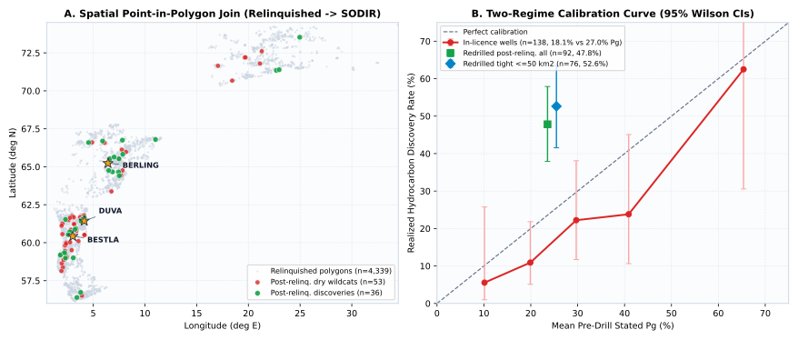

# Screened Relinquished Prospect Inventory and Conditional Audit of 756 NCS Licences

**Bottom line.** Cleaning 756 Norwegian Continental Shelf relinquishment reports (`10.5281/zenodo.24528585`, 738 unique licences and 5,325 prospects) and joining their prospect polygons against 536 active SODIR licences, the APA gross boundary, and 154 in-service surface host facilities identifies **242 APA-eligible open-acreage prospects (`Pg >= 0.20`, post-award assessed, undrilled, >=50% outside active licences) holding 6.30 Bboe unrisked and 1.95 Bboe risked**. Within that APA-open set, **178 prospects (1.31 Bboe risked) were dropped for commercial or non-technical reasons**, and **91 prospects (0.64 Bboe risked) lie within 30 km of an in-service host facility**. Testing post-relinquishment redrills collapsed to unique parent wells (`n = 81`) against a basin-and-year-matched leave-out shelf baseline (56.4%) with outcome-blind formation-top stratigraphic matching shows **no discovery-rate outperformance** (40.7% overall, 45.5% vs 56.0% on formation-top matched wells). All in-licence calibration and shrinkage metrics are strictly **conditional on relinquishment**.

---

## 1. APA-Eligible Open-Acreage Inventory and Tieback Shortlist

**Bottom line.** Filtering to georeferenced, post-award assessed, undrilled, non-redrilled prospects with `Pg >= 0.20` (`n = 408`, 3.07 Bboe risked) shows **243 prospects (59.6%, 1.95 Bboe risked) have at least half their polygon outside active SODIR licences**, and **242 of those 243 fall inside the annual APA area** (only 1 sits outside APA in numbered-round acreage).

- **Explicit filter hierarchy.** Removing pre-work application-only assessments (such as Wegener and Nobel in PL694), removing prospects already penetrated by post-relinquishment SODIR wildcats (such as Celsius and Herzer), and deduplicating straddling prospect names yields 408 georeferenced prospects. Splitting by relinquishment reason separates **Tier A (commercial or non-technical drop reasons, 178 APA-open prospects, 1.31 Bboe risked)** from **Tier B (technical or geological-risk drop reasons, 64 APA-open prospects, 0.64 Bboe risked)**.
- **Polygon overlap and depth-limited licences.** Rather than testing centroids alone, each prospect polygon was grid-sampled against all 536 active SODIR production licence polygons (FactMaps Layer 616) and the APA gross boundary (FactMaps Layer 603). None of the re-licensed prospects (`<50%` open) overlapped a stratigraphically depth-limited active licence (`prlStratigraphical == YES`).
- **Host facility tieback distances.** Haversine distance was computed from each prospect centroid to all 154 in-service surface facilities in SODIR `facility_fixed`. **91 APA-open prospects (0.64 Bboe risked)** sit within 30 km of an active surface host, though actual tieback feasibility still depends on host ullage and fluid compatibility.
- **Deduplication and unit fixes.** 18 duplicate multi-licence PDF pairs were collapsed to 738 unique licences and three 1,000x unit-scaling bugs (`PL531_JURASSIC`, `PL1019`, `PL883 Taren East`) were corrected. Undrilled status still relies on surface wellhead coordinates rather than deviated bottom-hole locations, so deviated wells spudded outside a polygon could have tested some targets.

### Source-Audited Top APA-Eligible Open-Acreage Prospects

| Prospect | Licence (Year) | Basin | Tier | Pg | Unrisked / Risked (MMboe) | Open % | Nearest Host (km) | Source Audit |
| --- | --- | --- | --- | --- | --- | --- | --- | --- |
| Kelvin | PL653 (2016) | Norwegian Sea | Tier A | 35% | 184.9 / 64.7 | 100% | Aasta Hansteen (52.3) | Verified p.10 (29.4 BCM rec gas) |
| Sjampis | PL695 (2021) | Barents Sea | Tier A | 25% | 223.3 / 55.8 | 100% | Goliat FPSO (124.5) | Verified p.12 (35.5 MSm3 rec oil) |
| Fjellflokk Far East 1 | PL847 (2020) | Norwegian Sea | Tier A | 60% | 87.4 / 52.5 | 100% | Aasta Hansteen (65.4) | Verified p.26 (13.9 GSm3 rec gas) |
| Svartbakkestjerne Springar | PL847 (2020) | Norwegian Sea | Tier A | 42% | 118.1 / 49.6 | 100% | Aasta Hansteen (71.0) | Verified p.31 (663 bcf rec gas) |
| Faering East (Ula) | PL809 (2018) | North Sea | Tier B | 34% | 136.0 / 46.2 | 100% | Tambar (14.3) | Verified p.6 (136 Mboe, outside PL809) |
| Maiblom | PL944 (2021) | Norwegian Sea | Tier B | 32% | 143.0 / 45.8 | 94% | Aasta Hansteen (145.8) | Verified p.14 (143 mmboe rec) |
| Faering South | PL809 (2018) | North Sea | Tier A | 29% | 146.0 / 42.3 | 100% | Tambar (11.7) | Verified p.4 (146 Mboe, Sand 2) |
| Firebird | PL678S (2017) | North Sea | Tier B | 28% | 122.3 / 34.2 | 100% | Ringhorne (56.6) | Verified p.41 (122.3 mmboe Brent) |
| Fannaraken | PL450 (2014) | North Sea | Tier B | 30% | 90.6 / 27.2 | 100% | Ula QP (14.5) | Verified p.27 (14.4 GSm3 HPHT gas) |
| Arenaria | PL709 (2017) | Barents Sea | Tier A | 56% | 47.9 / 26.8 | 100% | Johan Castberg (159.5) | Verified p.14 (7.61 GSm3 tight gas) |
| Birkeland | PL694 (2016) | Norwegian Sea | Tier A | 39% | 66.7 / 26.0 | 100% | Aasta Hansteen (51.9) | Verified p.10 (10.6 BCM rec gas) |
| Edinburgh (border caveat) | PL660 (2016) | North Sea | Tier A | 44% | 211.5 gross / ~20.5 NO | 100% | Ekofisk B (31.0) | Verified p.24 (only ~22% in Norway) |
| Jaktfalk (basis caveat) | PL595 (2014) | Barents Sea | Tier A | 28% | 170.5 / 47.7 | 100% | Goliat FPSO (92.5) | Caveat p.8 (basis/risking unstated) |
| Bjork Intra Heather Lower | PL1051 (2023) | North Sea | Tier B | 21% | 240.5 / 50.5 | 100% | Gjoa (24.5) | Unverified (no quote or page cited) |

---

## 2. Outcome-Blind Parent-Well Redrills vs Basin-and-Year Baseline

**Bottom line.** Collapsing overlapping prospect polygons and correlated sidetracks to unique parent wells (`wlbWell`, `n = 81`) and benchmarking against a basin-and-year-matched leave-out wildcat baseline (56.4%) shows **no redrill outperformance** (40.7% overall, -15.7 pp, z = -2.85). Using outcome-blind stratigraphic matching from FactPages `wellbore_formation_top` eliminates the discovery-biased jump seen when using hydrocarbon-bearing age fields, yielding 45.5% on matched wells (`n = 11`) vs 44.0% on unmatched wells (`n = 50`).

**Method.** Undrilled relinquished prospect polygons were matched by point-in-polygon to completed SODIR wildcats (`wlbCompletionYear > report_year`) and collapsed to one observation per parent well (`wlbWell`). To test whether a well penetrated the target stratigraphic period without conditioning on discovery outcome, each wellbore's penetrated units in `wellbore_formation_top.parquet` were mapped to geological periods via `strat_litho_overview` (never using `wlbAgeWithHc*`). Baseline discovery rates were computed from all remaining NCS wildcat parent wells matched by `(wlbMainArea, wlbCompletionYear)` after leaving out the redrill parent wells themselves.

| Unique Parent-Well Cohort | Parent Wells (n) | Discoveries | Observed Rate | Basin+Year Leave-Out Baseline | Diff (pp) | z-stat |
| --- | --- | --- | --- | --- | --- | --- |
| All unique parent wells | 81 | 33 | 40.7% | 56.4% | -15.7 | -2.85 |
| Vertical-only parent wells | 39 | 16 | 41.0% | 55.8% | -14.7 | -1.85 |
| Tight polygons (`<= 50 km2`) | 68 | 29 | 42.6% | 55.6% | -12.9 | -2.14 |
| Outcome-blind formation-top matched | 11 | 5 | 45.5% | 56.0% | -10.5 | -0.70 |
| Outcome-blind formation-top unmatched | 50 | 22 | 44.0% | 53.3% | -9.3 | -1.32 |
| Vertical + tight + blind strat matched | 8 | 4 | 50.0% | 54.6% | -4.6 | -0.26 |

- **Standalone fields vs near-field satellites.** `6506/11-10 Berling` (2018, relinquished twice by Det norske in 2011 and Centrica in 2015) and `31/7-1 Bestla` (2016, dropped by Lundin in 2013) represent standalone field discoveries. `6507/4-2 S Adriana` (filed under `DVALIN`) and `36/7-5 B` (filed under `DUVA`) are near-field satellites.
- **Coordinate limitation.** FactPages coordinates reflect surface wellheads rather than reservoir penetration points, which is why vertical-only subsets are reported separately.

---

## 3. Exploratory P90 to P10 Volume Coverage Note

**Bottom line.** Across 10 standalone SODIR discoveries (`discovery_reserves`) matched to tight (`<= 100 km2`) relinquished polygons with pre-drill `[P90, P10]` ranges, 8 of 10 (80.0%, 95% Wilson CI 49% to 94%) fall inside `[P90, P10]`, with 2 above P10, 0 below P90, and a median actual-to-pre-drill-mean ratio of 1.11x.

- **Caveats.** Three factors prevent drawing calibration conclusions from this note. First, `n = 10` leaves a wide 49% to 94% confidence interval that cannot distinguish good calibration from under-coverage. Second, matching only later discoveries selects a favourable upward-skewed subset. Third, the ranges are the relinquishing operator's final post-shrinkage estimates rather than the discovering operator's pre-drill estimates. Four additional matches to `field_reserves` aggregate multi-well field totals and are excluded.

---

## 4. Conditional Patterns Inside Relinquished Licences

**Bottom line.** All metrics in this section are **conditional on licence relinquishment**. Because licences with commercial discoveries or growing prospects generally remain active, sample conditioning shifts outcomes toward lower discovery rates and shrinking volumes.

- **Conditional in-licence discovery rate (`n = 138`).** Within relinquished licences, mean stated pre-drill `Pg` is 27.0% against an 18.1% realized hydrocarbon discovery rate (-8.9 pp, p = 0.0134), reflecting disappointment inside dropped licences rather than unconditional shelf-wide calibration.
- **Conditional award-to-relinquishment volume drift.** Among re-evaluated pairs with both award and relinquishment assessments (`n = 183` mean volume, `n = 165` risked volume), 79.2% shrink in mean volume (median -52.0%) and 83.0% lose risked volume (median -61.4%). Decade drift comparisons are omitted due to right-censoring of 2020s licences.
- **Conditional dry-hole causes (`n = 214` dry holes).** Reservoir absence or quality accounts for 47.6% of documented dry-hole causes vs 21.5% of pre-drill top risk ratings, while trap accounts for 5.9% of dry-hole causes vs 29.5% of pre-drill top risk ratings. Both selection (trap-risked prospects are often dropped undrilled) and diagnosis bias (water-wet good reservoir is often attributed to charge rather than trap) contribute to this gap.
- **Operator Pg spread.** Basin-adjusted stated `Pg` spans 16.5 pp across major operators (`n >= 20`, DNO +9.6 pp and Wintershall Dea +6.7 pp vs Neptune/ENGIE -6.8 pp, ConocoPhillips -5.3 pp, Shell -4.4 pp, and Lundin -4.2 pp). Without unconditional outcomes and play/vintage controls, this reflects reporting conventions and portfolio mix rather than proven optimism.

---

## 5. DHI Patterns and 18-PDF Extraction Reproducibility

**Bottom line.** Across drilled prospects in the atlas, positive DHI yields a 54.2% technical discovery rate vs 22.6% for negative DHI (p = 5.6e-5), reproducing known NCS DHI behavior (including Barents uplift gas expansion, where positive DHI lifts technical success 2.5x from 26.9% to 68.4% with 84.6% gas-only hits vs 6.7% in the North Sea). Across 18 duplicate joint-licence PDFs independently processed twice by Claude, true VLM map digitizations (`n = 52`, excluding GIS shapefiles) show 0.861 median polygon IoU and 116.8 m median centroid shift.

- **Flat-spot contrast (exploratory).** Claimed `flat_spot` prospects hit 28.0% (7/25) overall and 12.5% (1/8) in the North Sea vs 69.0% (29/42) for positive `amplitude_conformance` (unadjusted Fisher p = 0.0018, not corrected for multiple testing).
- **Reproducibility vs accuracy.** Inter-run agreement on the 18 duplicate PDFs (100.0% reservoir period, 95.5% `Pg`, 92.2% volume, 0.861 median VLM polygon IoU) measures self-consistency only, not ground-truth accuracy, since repeated runs can share systematic extraction errors.

---

## Reproducibility

- Shared loader and deduplicator `src/loader.py`
- Outcome-blind parent-well audit, APA polygon-fraction screen, and host-facility distance ranking `analyses/track6_production_audit.py`
- Earlier exploratory track scripts `analyses/track1_redrilled_graveyard.py` through `analyses/track5_reviewer_upgrades.py`
- Matplotlib PNG and SVG generator `analyses/generate_figures.py`
