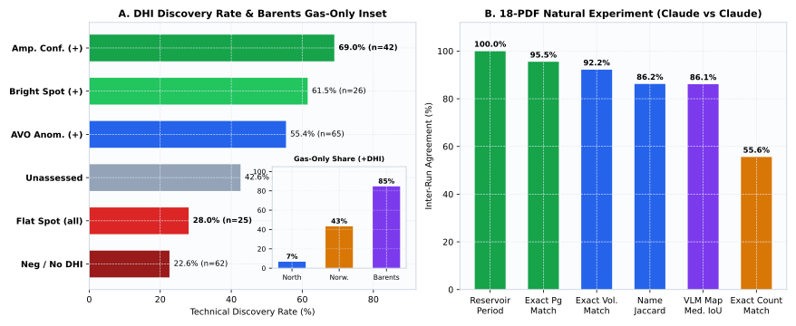

# Empirical Audit of 756 Norwegian Continental Shelf Relinquishment Reports

**Bottom line.** Cross-referencing 738 deduplicated Norwegian Continental Shelf licence relinquishment reports (5,325 prospects) against 2,149 completed SODIR FactPages exploration wells reveals four structural patterns in offshore exploration decisions. In-licence drilling is systematically overconfident (18.1% realized discovery rate against 27.0% mean pre-drill Pg, p = 0.013), yet relinquished prospects later redrilled by fresh operators hit 50.0% discoveries and four producing or approved fields. Across 214 dry holes, reservoir failure causes 47.6% of dry holes while trap failure causes 5.9%, reversing pre-drill fears. Between licence award and relinquishment, 79.2% of re-evaluated prospects shrink with a median risked-volume cut of 61.4%, and in the Barents Sea positive direct hydrocarbon indicators triple technical success to 68.4% while yielding 84.6% gas-only hits.

---

## Data Cleaning and Scope

**Bottom line.** All analyses run on 738 unique licences and 5,325 prospects after removing 18 duplicate multi-licence reports and correcting three 1,000x unit-scaling errors in the source Zenodo release (`10.5281/zenodo.24528585`).

- **Multi-licence deduplication.** 18 joint relinquishment PDFs appear twice under paired licence NPDIDs (such as PL1003 and PL1003B, PL1043 and PL1043B, PL785S and PL785SB). Retaining the richer extraction per `licence_id` prevents double-counting roughly 150 prospects.
- **Unit-scale corrections.** Three upstream unit errors inflated canonical volumes by 1,000x and were corrected before aggregation (`PL531_JURASSIC` bcf converted with the tcf factor 28.3168, `PL1019` GSm3 OE header multiplied by 1,000 against explicit MSm3 OE text, and `PL883 Taren East` condensate mistyped as 1e9 Sm3).
- **Spatial join.** Every prospect and lead GeoJSON polygon (3,476 unique polygons) was tested via ray-casting point-in-polygon against completed SODIR exploration well coordinates (`wlbEwDecDeg`, `wlbNsDecDeg`) from `wellbore_exploration_all.parquet`.

---

## 1. Two-Regime Calibration and Post-Relinquishment Redrills

**Bottom line.** Operators over-predict success by 8.9 percentage points when drilling inside active licences, yet strictly undrilled prospects handed back at relinquishment achieve a 50.0% discovery rate when later penetrated by wildcats, with 100% of field discoveries made by a different returning operator.

**Method.** Panel A plots all relinquished prospect polygon centroids in gray against post-relinquishment SODIR wildcat penetrations (`wlbCompletionYear > report_year`), separating dry holes (red), discoveries (green), and named fields (gold stars). Panel B bins strict in-licence exploration wells (`n = 138`, excluding appraisal wells with `Pg = 1.0`) by stated pre-drill `Pg` with 95% Wilson confidence intervals and overlays the out-of-sample redrilled relinquishments.

| Cohort | Prospects (n) | Mean Pre-Drill Pg | Realized Discovery Rate | Gap (pp) | Statistical Test |
| --- | --- | --- | --- | --- | --- |
| Strict in-licence exploration | 138 | 27.0% | 18.1% (25/138) | -8.9 | z = -2.47, p = 0.0134 |
| Commercial-only in-licence | 138 | 27.0% | 8.0% (11/138) | -19.0 | p < 0.0001 |
| Redrilled post-relinquishment (all) | 130 | 24.0% (n=86) | 50.0% (65/130) | +22.5 (on n=86) | Binomial p = 1.0e-6 |
| Redrilled tight polygons (<= 50 km2) | 76 | 25.5% | 52.6% (40/76) | +27.2 | p < 1.0e-9 |
| Different operator returning | 97 | n/a | 53.6% (52/97) | 9/9 fields | 45.3% unique wildcats |
| Same operator / successor returning | 33 | n/a | 39.4% (13/33) | 0/9 fields | 34.8% unique wildcats |

- **Northward overconfidence gradient.** In-licence calibration bias widens from -6.5 pp in the North Sea (`n = 90`) to -8.9 pp in the Norwegian Sea (`n = 41`) and -16.3 pp in the Barents Sea (`n = 19`, 26.8% predicted vs 10.5% realized).
- **Four fields relinquished before discovery.** `6506/11-10 Berling` (`BERLING`, OMV 2018, relinquished twice by Det norske in 2011 and Centrica in 2015), `31/7-1 Bestla` (`BESTLA`, Faroe 2016, dropped by Lundin in 2013 as too small), `6507/4-2 S` (`DVALIN`, Wintershall Dea 2021, dropped by Maersk in 2014 at 36% Pg), and `36/7-5 B` (`DUVA`, Var Energi 2024, dropped by Shell in 2015 at 9% Pg).
- **False-negative vs true-positive drop reasons.** Relinquished prospects later redrilled after being dropped for `commercial` (63.2% hit rate) or `trap_risk` (61.9%) frequently succeeded, while `migration_risk` (28.6%) and `seal_risk` (35.5%) warnings mostly held up.

---

## 2. Reservoir Blind Spot and Operator Optimism Fingerprints

**Bottom line.** Reservoir absence or poor quality kills 47.6% of dry holes despite ranking third in pre-drill fear (21.5%), whereas trap risk accounts for 29.5% of pre-drill fear but only 5.9% of actual dry holes. Across major operators, basin-adjusted stated `Pg` spans 16.5 percentage points.

**Method.** Panel A compares the lowest pre-drill risk factor across 891 four-factor prospects against documented post-drill failure mechanisms across 214 dry holes (271 factor mentions). Panel B computes each operator's mean stated `Pg` minus the basin-weighted average `Pg` across operators with at least 20 risked prospects.

- **Quantitative blind spot.** In matched four-factor dry holes killed by reservoir failure (`n = 6`), reservoir was not the lowest-rated pre-drill risk factor in 5 of 6 wells (83.3%).
- **Operator calibration spread.** DNO (+9.6 pp) and Wintershall Dea (+6.7 pp) report the highest basin-adjusted `Pg`, while Neptune/ENGIE (-6.8 pp), ConocoPhillips (-5.3 pp), Shell (-4.4 pp), and Lundin (-4.2 pp) report the lowest. Median P10/P90 volume ratios span 4.8x from Wellesley (3.61x) and Aker BP (3.94x) to Spirit/Centrica (17.35x) and OMV (16.95x).
- **Probability math gap.** Across 1,240 assessments with all four risk elements and a stated `Pg`, 14.4% (179) deviate from `P_res * P_trp * P_chg * P_ret` by more than 0.5 pp, tilting 2.1 to 1 downward at material gaps above 1.5 pp (80 lower vs 38 higher).

---

## 3. Post-Award Volume Shrinkage and the Untested Prize

**Bottom line.** Among re-evaluated prospects with paired award and relinquishment assessments, 79.2% shrink in volume (median cut -52.0%) and 71.9% drop in `Pg` (median -6.0 pp), wiping 61.4% off median risked volume. Shrinkage is sharpest in the North Sea (-60.8%) and intensified in the 2020s (-52.1% portfolio cut).

**Method.** Panel A plots award or application mean recoverable volume against final relinquishment mean recoverable volume on log-log axes for re-evaluated pairs (`n = 183`, excluding unchanged carry-overs), compared against the 1 to 1 diagonal and the 0.48x median cut line. Panel B plots the `log2(Final / Award)` distribution of risked volume (`Pg * Mean`, `n = 165`), shading shrinking prospects in red (83.0%) and growing prospects in green (17.0%).

| Metric | Paired Sample (n) | Share Shrinking | Median Ratio | Portfolio Change |
| --- | --- | --- | --- | --- |
| Mean volume (re-evaluated) | 183 | 79.2% | 0.480x (-52.0%) | -41.3% (all 248 pairs) |
| Risked volume `Pg * Mean` | 165 | 83.0% | 0.386x (-61.4%) | -48.3% |
| North Sea re-evaluated volume | 71 | 83.1% | 0.392x (-60.8%) | -62.7% |
| 2020s award cohort volume | 71 | 63.4% | n/a | -52.1% (Pg -5.1 pp) |
| 2010s award cohort volume | 163 | 55.2% | n/a | -37.9% (Pg -2.2 pp) |

- **Non-technical walk-away drivers.** Across all 738 licences, 34.4% (254) cite infrastructure or host capacity constraints (peaking at 45.1% in the Barents Sea), 14.0% cite licence expiry, and 13.6% (100) document partner disagreement, failed farm-outs, or sole-risk splits.
- **Untested relinquished inventory.** Filtering to deduplicated, post-award assessed, undrilled prospects with `Pg >= 0.20` dropped for commercial or non-technical reasons yields 355 prospects holding 1,496.7 MSm3 o.e. (9.41 Bboe) unrisked and 471.3 MSm3 o.e. (2.97 Bboe) risked, led by the Norwegian Sea (46.0% of risked volume).

---

## 4. Barents DHI Gas-Trap Paradox, Flat Spots, and VLM Map Consistency

**Bottom line.** Positive direct hydrocarbon indicators boost technical discovery rates to 54.2% against 22.6% for negative DHI (p = 5.6e-5), but claimed flat spots underperform the unassessed baseline at 28.0%, and 84.6% of Barents positive-DHI discoveries are gas-only. Across the 18 duplicate multi-licence PDFs extracted twice independently by Claude, true VLM map digitizations achieve 0.861 median polygon IoU and 116.8 m median centroid shift.

**Method.** Panel A compares technical discovery rates across seismic DHI categories (with inset showing the gas-only share of positive-DHI discoveries by basin). Panel B isolates the 18 duplicate joint-licence PDFs that were independently processed twice, separating companion GIS shapefiles (`n = 48`, IoU 1.000) from true independent VLM map digitizations (`n = 52`, `geometry_source.method == digitised_figure`) to measure geometric and tabular reproducibility.

- **Flat spot trap vs amplitude conformance.** Positive `amplitude_conformance` reaches 69.0% (29/42) and positive `bright_spot` reaches 61.5% (16/26), while claimed `flat_spot` hits 28.0% (7/25) overall and 12.5% (1/8) in the North Sea (Fisher p = 0.0018 vs amplitude conformance).
- **Barents gas-only skew.** Positive DHI triples Barents technical discovery rates from 26.9% (25/93) to 68.4% (13/19, p = 0.001), yet 11 of 13 hits are gas-only (84.6%) compared to 1 of 15 (6.7%) in the North Sea (p = 5.4e-5), with only 1 of 19 finding commercial oil.
- **Play and depth extremes.** Cretaceous prospects hit 49.1% (78/159, 15.0 MSm3 mean) against Permian at 18.8% (6/32, p = 0.0016). Deep HPHT closures below 4,500 m hit 80.0% (12/15, p = 0.0051), with 83.3% gas or gas-condensate.
- **LLM/VLM extraction reproducibility (`n = 18` duplicate PDF pairs).** Reservoir period matches 100.0% (129/129), exact `Pg` matches 95.5% (84/88, MAE 0.11 pp), exact volume matches 92.2% (71/77, median diff 0.0%), prospect name Jaccard averages 0.862, and independent VLM polygon traces achieve 0.861 median IoU (92.3% at IoU >= 0.50, median area diff 7.95%).

---

## Reproducibility

All scripts and structured outputs live in this repository.

- Shared loader and deduplicator `src/loader.py`
- Track 1 redrilled spatial join `analyses/track1_redrilled_graveyard.py`
- Track 2 calibration and dry-hole audit `analyses/track2_risk_calibration.py`
- Track 3 award-to-relinquishment drift and prize `analyses/track3_volume_drift_and_prize.py`
- Track 4 DHI paradox, plays, and 18-PDF LLM benchmark `analyses/track4_dhi_plays_and_llm_consistency.py`
- Matplotlib PNG and SVG figure generator `analyses/generate_figures.py`
